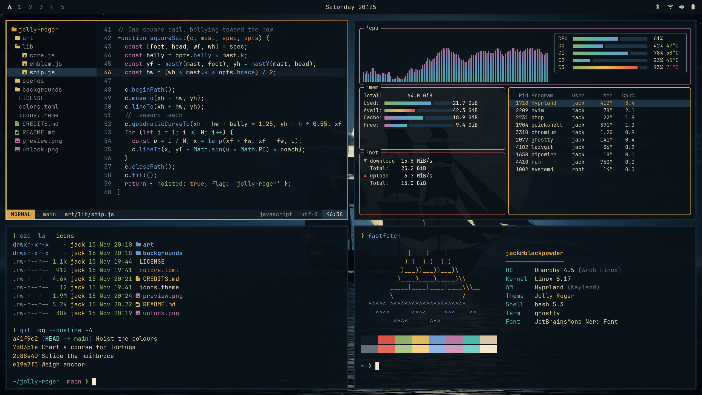
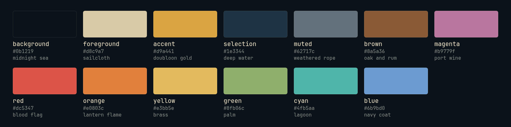
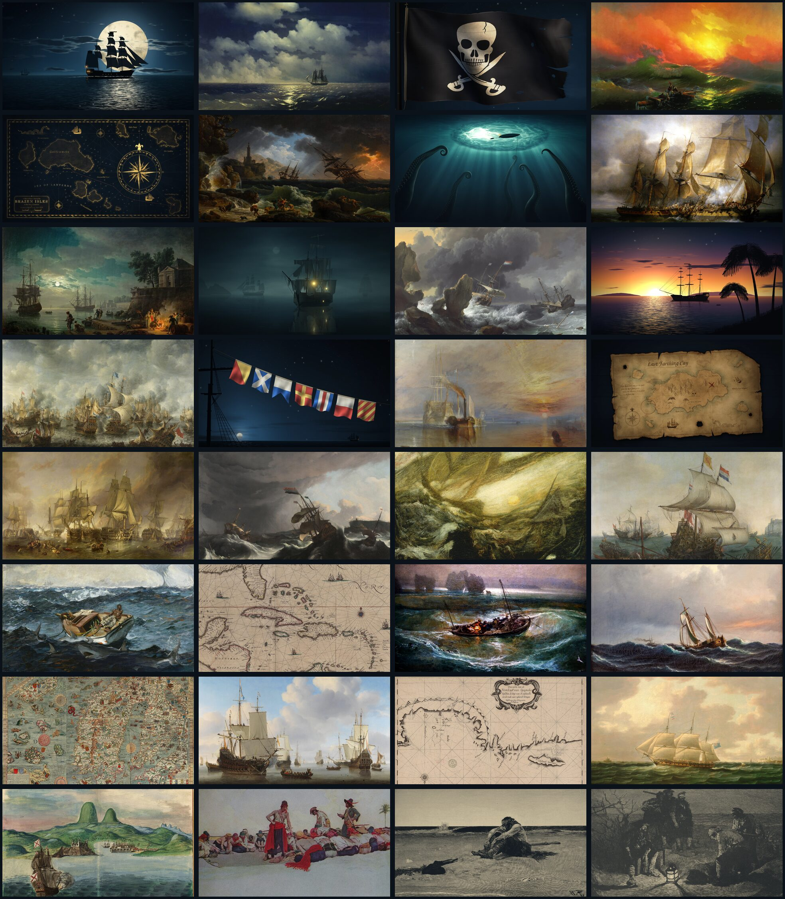

# Jolly Roger

An [Omarchy](https://omarchy.org) theme for the age of sail: tarred-oak night,
sailcloth text and doubloon gold, with 32 wallpapers that run from Aivazovsky
and Turner to a kraken's-eye view of your ship.



## Install

```bash
omarchy theme install https://github.com/chrisduvillard/omarchy-jolly-roger-theme
```

Or from the Omarchy menu: **Install → Style → Theme**, and paste the URL.

Cycle the wallpapers with `omarchy theme bg next`, or pick one from the
background switcher (`omarchy theme bg-switcher`). To put the skull and
cutlasses on your boot and unlock screen, choose **Style → Unlock → Jolly
Roger**.

## The palette



The accent and all seven ANSI hues clear 4.5:1 contrast against the
background; body text sits at 11.5:1. Active windows get a gilded border that
fades from brass to oak.

Omarchy generates the rest from [`colors.toml`](colors.toml): Alacritty,
Ghostty, Kitty and Foot, Neovim, VS Code, Helix, btop, the bar, launcher,
notifications and lock screen, Chromium, Obsidian and more. Themes installed
from a git repository are only allowed to supply colours, so that one file is
the whole theme. File-manager icons use `Yaru-yellow`.

## The wallpapers



**Eight originals**, painted in code for this theme:

| | |
| --- | --- |
| `01-black-sails` | A ship crossing a low moon, a pursuer hull-down astern. The default, with an animated intro: the moon rises and the ship sails in when you switch to the theme. |
| `03-jolly-roger` | The black flag itself. |
| `05-dead-reckoning` | A night chart of an imaginary archipelago, in gilt on midnight vellum. |
| `07-the-deep` | Looking up from the kraken's side of the water. |
| `10-ghost-ship` | A derelict coming out of the fog. |
| `12-safe-harbour` | At anchor off a palm cay at sundown. |
| `14-signal-flags` | O-M-A-R-C-H-Y in signal flags. |
| `16-treasure-map` | The same archipelago as a weathered treasure map. |

**Twenty-four public-domain works**, cropped to 16:9: Aivazovsky's *Ninth
Wave* and *Brig Mercury*, Turner's *Fighting Temeraire* and *Fishermen at Sea*,
Vernet's shipwreck and moonlit harbour, Bakhuizen's storms, Crépin's boarding of
the *Embuscade*, Stanfield's *Trafalgar*, Homer's *Gulf Stream*, Ryder's
*Flying Dutchman*, three Howard Pyle pirate illustrations, and four period
charts including Blaeu's Caribbean and a 1670s pilot chart of Tortuga.
[`CREDITS.md`](CREDITS.md) lists every one with its artist, date and source.

Most are dark and sit quietly behind terminals. A few are deliberately bright
(the charts, van de Velde's calm, *The Gulf Stream*) for when you want daylight.

## Rebuilding the art

Everything generated is reproducible from [`art/`](art/):

```bash
cd art
npm install          # playwright-core, drives your system Chromium
./build.sh           # originals, boot logo, previews, gallery
./build.sh --fetch   # also re-download and rebuild the paintings
./build.sh --intro   # also re-render the animated intro
node render.mjs black-sails --scale 0.33 --out out/draft.png   # one scene, quick draft
```

Scenes are plain JavaScript modules drawing on an HTML canvas
(`art/scenes/*.js`), sharing a small library for noise, colour and a procedural
full-rigged ship (`art/lib/`). Needs Node, Chromium, ImageMagick and, for the
intro video, ffmpeg.

`preview.png` is rendered from the palette over a mock desktop rather than
captured from a live session.

## Licence

Code, original artwork and theme files are [MIT](LICENSE). The paintings,
charts and illustrations are in the public domain; see
[`CREDITS.md`](CREDITS.md).
